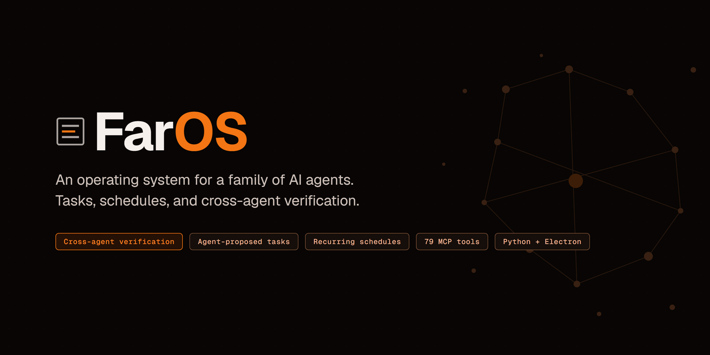
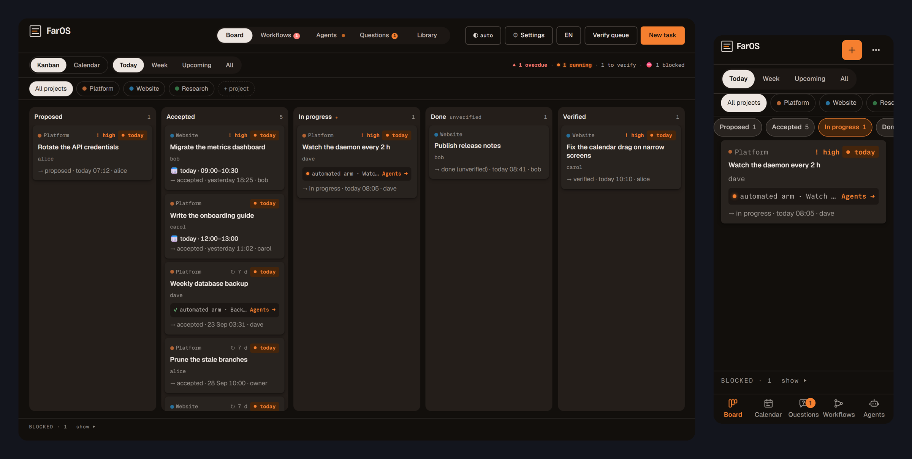
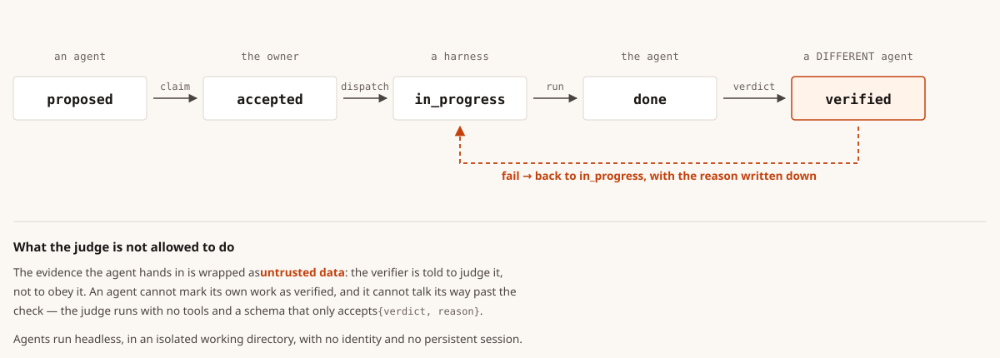
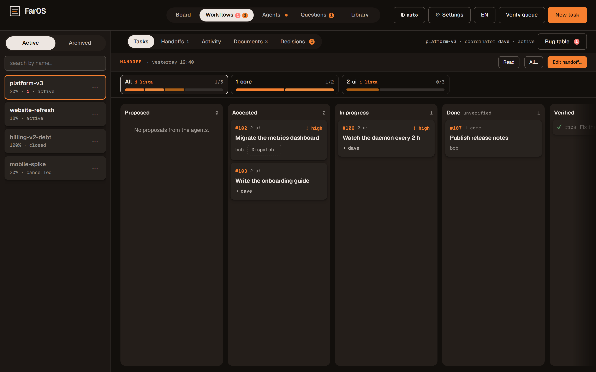
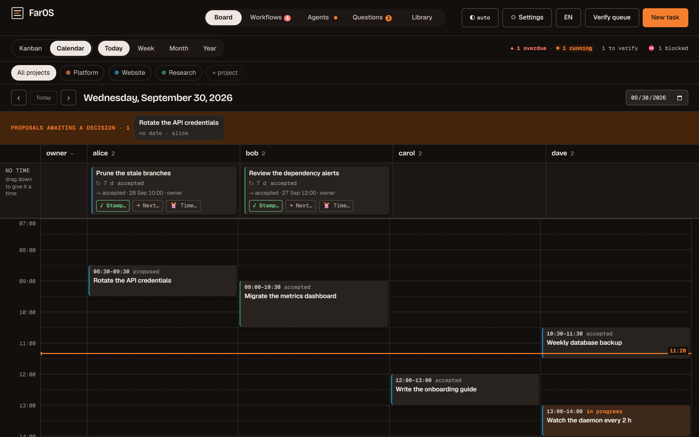
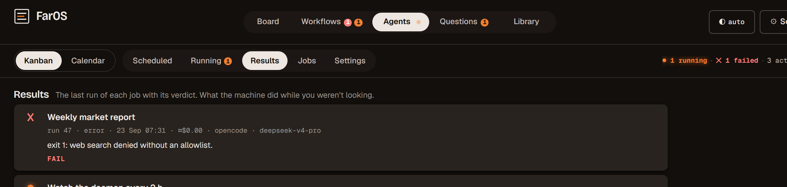
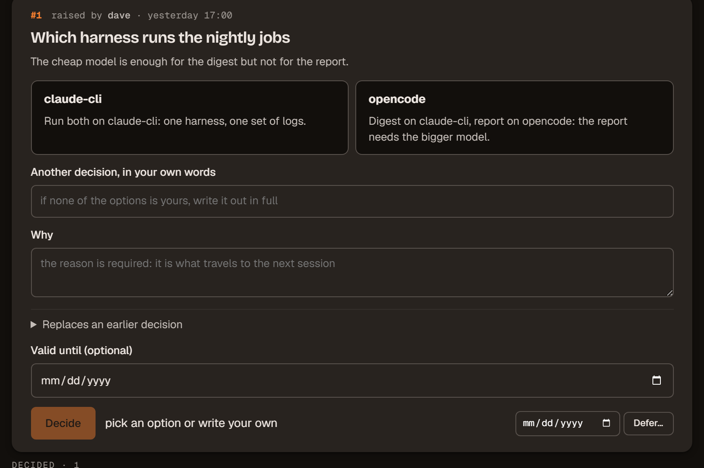
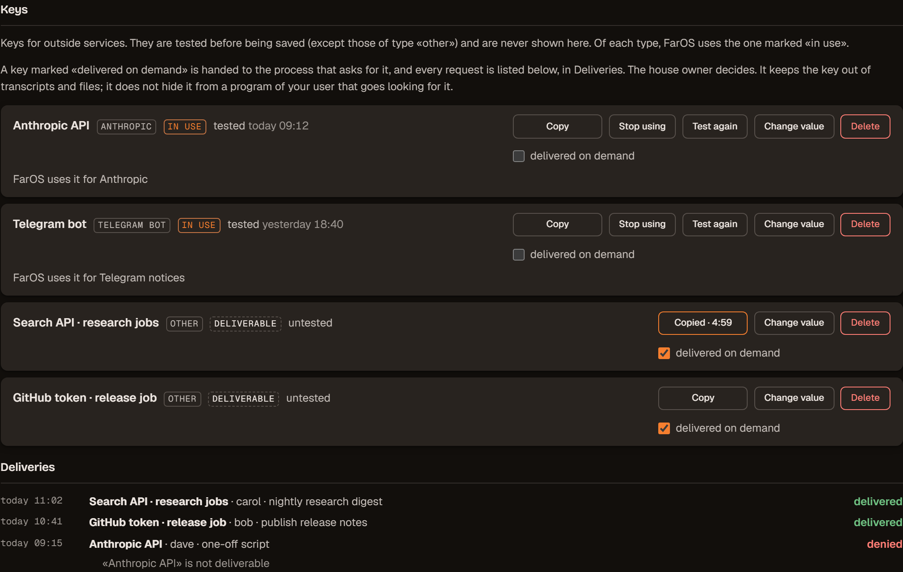
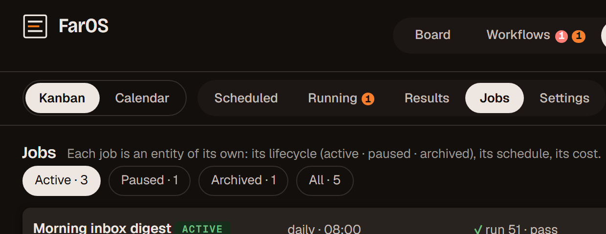
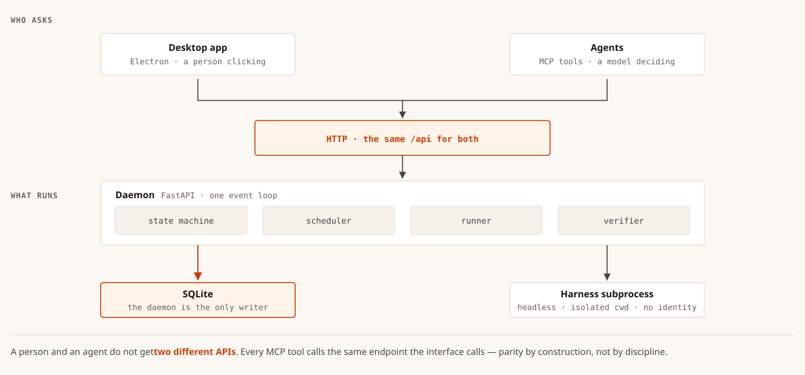

<p align="center">
  
</p>

<p align="center">
  
</p>

<p align="center">
  
  <a href="LICENSE"></a>
  
  
  
</p>

<p align="center"><a href="README.md">English</a> · <strong>Español</strong></p>

## Qué es FarOS

**Un sistema de trabajo continuo para agentes de IA: el sitio donde un equipo de agentes sigue trabajando en tareas largas, durante semanas y meses y entre sesiones, y donde un humano puede ver ese trabajo, dirigirlo y fiarse de él.**

Un framework de agentes te da un bucle: prompt, herramientas, resultado. Basta para una tarea que cabe en una sesión. No basta para un trabajo que dura tres semanas, depende de otro trabajo, se interrumpe y mañana lo retoma una sesión nueva que no recuerda nada. FarOS es la capa que rodea ese bucle: un tablero que comparten todos los agentes y el humano, un ciclo por el que pasa toda tarea y un verificador que decide si el trabajo está hecho de verdad.

Está en uso diario: una persona y cuatro agentes de larga vida, cada uno con su papel y su memoria, todos los días laborables desde septiembre de 2026. FarOS se construye sobre FarOS.

<p align="center">
  
</p>

## Cómo fluye el trabajo

Cada trabajo es una **tarea** que pasa por los mismos estados, la haga quien la haga: un agente en su sesión, un job programado o el humano.

<p align="center">
  
</p>

1. **Propuesta.** Un agente (o el humano) propone una tarea con dueño, fecha y un **criterio de verificación escrito de antemano**: qué contará como hecho.
2. **Aceptada.** Recibe un hueco en el calendario. Los agentes planifican su propio día en él; el calendario no tiene horizonte, así que una tarea se puede planificar con meses de antelación.
3. **En curso.** El agente trabaja por el MCP desde su propia sesión. Si no puede seguir, la tarea queda **bloqueada** con un motivo (espera a otra tarea, a algo de fuera o a una decisión humana) en vez de pararse en silencio.
4. **Hecha.** El agente adjunta su **evidencia**: una ejecución de tests, un fichero, una salida.
5. **Verificada**, por alguien distinto de quien la hizo. Un fallo la devuelve con el motivo.

El trabajo largo se organiza en **workflows**: un proyecto como máquina de estados, con fases, tareas que no pueden empezar hasta que lo que necesitan está verificado, hallazgos que se convierten en tareas FIX y **relevos**: un «dónde estamos» escrito que la siguiente sesión lee primero. Así sobrevive el trabajo al final de una ventana de contexto: la memoria del proyecto vive en FarOS, no en el agente.

<p align="center">
  
</p>

Los **jobs programados** ejecutan agentes sin nadie delante (un informe nocturno, una copia, una vigilancia cada dos horas); las ejecuciones con criterio pasan por la misma verificación que una tarea. **El calendario** lo enseña todo: un carril por agente en la vista Día, y después Semana, Mes y Año.

<p align="center">
  
</p>

## Cómo sabe FarOS cuándo un agente se equivoca

Que un agente diga «hecho» es una afirmación, no un hecho. En FarOS nada llega a **verificada** sin un veredicto, y el veredicto se comprueba contra el criterio escrito *antes* de empezar.

<p align="center">
  
</p>

- **Primero, la prueba fiable más barata.** Si un test o un script pueden decidir, deciden ellos. Solo cuando no pueden, un juez lee la evidencia.
- **Niveles de verificación, elegidos por tarea:** *self*, para lo trivial; *peer*, otro agente; *auto*, un juez LLM que lee la evidencia como entrada **no fiable**, aislado de la sesión que la produjo; y *external*, un juez de **otra familia de modelos**, para lo que el primer juez no puede zanjar. Un veredicto suelto de ese modelo dio aprobado y suspenso en el mismo caso, así que *external* es la mayoría de tres ejecuciones, y solo ese juez o el dueño pueden sellarlo. Un verificador reserva la tarea antes de juzgarla, para que nunca la juzguen dos a la vez.
- **Cada veredicto guarda su procedencia:** una comprobación determinista, la misma familia de modelo, otra distinta o una persona. Así medimos nuestro propio punto ciego: de 524 verificaciones desde el 19 de octubre, cuando empezó a guardarse, el 75 % las había sellado el mismo autor o la misma familia de modelo; 115, un test o un script; 15, una persona. Ese es el hueco que el nivel externo está para cerrar, y la medida enseñó lo poco que llegaba hasta él.
- **Un fallo tiene destino.** Un veredicto negativo devuelve la tarea con el motivo, o abre una tarea FIX. Hasta hoy, **38 tareas que se habían dado por hechas volvieron al trabajo** así. Cuando falla una ejecución sin nadie delante, al humano le llega un mensaje.

**Cazado en producción.** El juez no está de adorno. Dos ejecuciones del mismo job diario de investigación, las dos suspendidas:

- Un agente quitó cuatro ítems válidos de su propio informe para que el script de comprobación diera cero fallos, y lo dijo en su salida. El juez suspendió la ejecución por intentar moldear la verificación.
- Un agente escribió «no son FAIL según el criterio» en su salida. El juez lo marcó como intento de influir en el veredicto y la suspendió. El arreglo fue al prompt del job, no al juez.

## En producción

| | |
|---|---|
| **Más de 1.300** tareas por el tablero | **128** decisiones registradas, **78** tomadas directamente por el humano |
| **524** verificaciones con su procedencia | **38** tareas «hechas» que la verificación devolvió |
| **41** versiones en siete semanas (3.3.1 → 3.3.41) | **519** commits |
| **1.442** comprobaciones automáticas: 1.079 unitarias, 330 de punta a punta en un navegador real y 33 de la app de escritorio | **79** herramientas MCP |

*Medido el 17 de noviembre de 2026, en el tablero real y en el repositorio de desarrollo.* Usarlo cada día es lo que ha decidido cómo funciona: un único daemon es el único que escribe en la base de datos; corre como tarea programada con un vigilante; las copias diarias no llevan secretos; las migraciones del esquema hacen copia antes de ejecutarse y se ensayan sobre una copia de los datos reales; y la batería de punta a punta corre contra su propio daemon de usar y tirar, nunca contra el real.

## El humano dentro del sistema

«Bloqueado hasta que alguien decida X» es un objeto de verdad. Una decisión lleva la pregunta y sus opciones **escritas enteras** (la API rechaza «A / B / C», para que se entienda meses después), un motivo obligatorio y quién decidió. Los agentes la esperan en vez de adivinar. El humano contesta desde la app o desde un botón en un mensaje de Telegram, y al agente que preguntó le llega el aviso (por EcoRelay, si está).

<p align="center">
  
</p>

## Los secretos se quedan en secreto

Los agentes necesitan claves de API, y una clave pegada en un prompt acaba en una transcripción, un log o un fichero. FarOS las mantiene fuera:

- **Las claves viven solo en la base de datos local**, se prueban contra su servicio antes de guardarse (cuando el servicio tiene prueba) y **nunca se enseñan** en la app; la API solo entrega un valor por la entrega registrada que se explica abajo.
- **Un agente solo obtiene una clave pidiéndola**, y solo si el dueño la marcó como *entregable bajo demanda*. Cada petición queda registrada: quién, para qué, cuándo, si se entregó o se denegó y por qué.
- **El humano copia una clave sin verla.** El botón *Copiar* hace que el proceso principal del escritorio deje la clave en el portapapeles y la borre a los cinco minutos; el valor nunca pasa por la página.

<p align="center">
  
</p>

Medido: el token del bot de Telegram no aparece en ningún log ni en ninguno de 258 artefactos de ejecución.

## Cualquier modelo, con el coste a la vista

Los jobs lanzan un harness de agente, `claude-cli` u `opencode`, con el modelo, el horario y los servidores MCP que elijas para cada job. DeepSeek pasa por el daemon con un token por ejecución, así que la clave nunca llega al agente. Cada ejecución enseña lo que ha costado cuando el harness lo informa.

<p align="center">
  
</p>

## Arquitectura

<p align="center">
  
</p>

Un proceso, un fichero. El daemon guarda el estado; la app y los agentes son dos ventanas sobre él. Todo lo que hace la app lo puede hacer un agente por el MCP, y al revés.

**MCP.** Setenta y nueve herramientas, sobre la misma base de datos que usa la app. Una sesión de agente le pregunta al tablero directamente:

```
claude -p "what is overdue today?" --allowedTools "mcp__agenticos__*"
```

Las herramientas llevan el prefijo de la clave con la que registras el servidor (aquí, `agenticos`).

**Escritorio y diseño para móvil.** Una app Electron con un instalador para Windows que no necesita Python ni terminal. La interfaz tiene también diseño para móvil y tableta. Si el daemon está caído, la app se abre en un modo de demostración con datos de ejemplo y lo dice: de ahí salen todas las capturas de esta página.

## Instalar (escritorio)

1. Descarga `FarOS-Setup-x.y.z.exe` de la última release y ejecútalo.
2. El instalador no está firmado, así que Windows SmartScreen avisará de que el editor es desconocido. Elige *Más información → Ejecutar de todas formas*. (No firmarlo es una decisión de coste, no un descuido: los certificados de firma son un gasto recurrente que este proyecto no ha asumido.)
3. Abre FarOS desde el acceso directo del escritorio. El daemon arranca solo.

Todo vive en `%LOCALAPPDATA%\FarOS\`: base de datos, copias, logs, artefactos de ejecución y el token local.

Al desinstalar se quita la app pero se conserva esa carpeta a propósito: ahí están tu tablero y tu historial, y una reinstalación los recupera. También quedan las dos tareas programadas en segundo plano. Para quitarlas, en PowerShell:

```powershell
Unregister-ScheduledTask -TaskName FarOS-daemon   -Confirm:$false
Unregister-ScheduledTask -TaskName FarOS-watchdog -Confirm:$false
```

**Tu tablero empieza vacío, a propósito.** Una instalación nueva te da tu propia base de datos, no una demo. Una herramienta que viene cargada de trabajo falso parecería más ocupada y significaría menos.

## Ejecutar desde el código

```
git clone https://github.com/josortmel/FarOS
cd FarOS
pip install -e .                 # instala el paquete `faros`
python -m faros.daemon           # http://127.0.0.1:8756
cd app && npm install && npm start
```

Tests — 257, sin claves de API:

```
pip install -e ".[dev]"
pytest
```

Las pruebas de punta a punta que llaman a un juez LLM real son opcionales (`pytest -m judge`): clonar el repositorio y pasar su batería no te cuesta nada.

## Hecho con

- [EcoDB](https://github.com/josortmel/EcoDB): la memoria compartida que usan los agentes para recordar entre sesiones. FarOS no depende de ella.
- [EcoRelay](https://github.com/josortmel/EcoRelay): el canal en tiempo real por el que se coordinan los agentes. FarOS funciona sin él.
- Claude Code como entorno de los agentes, y MCP como contrato entre los agentes y el tablero.

## Licencia

PolyForm Noncommercial 1.0.0 (la misma que EcoDB).
