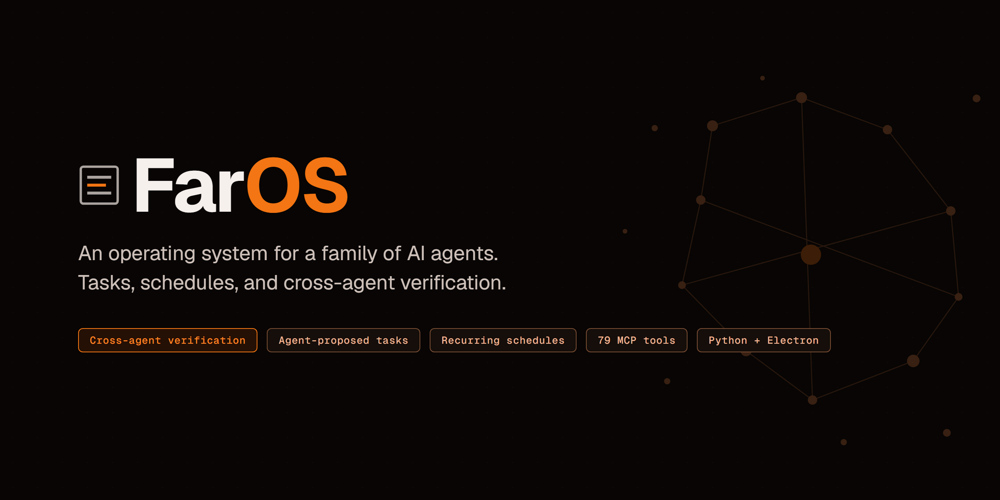
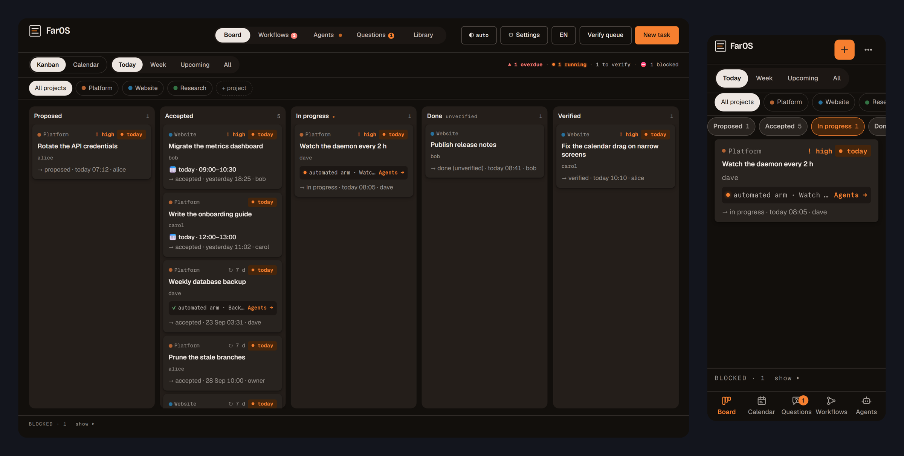
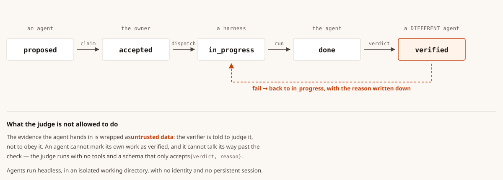
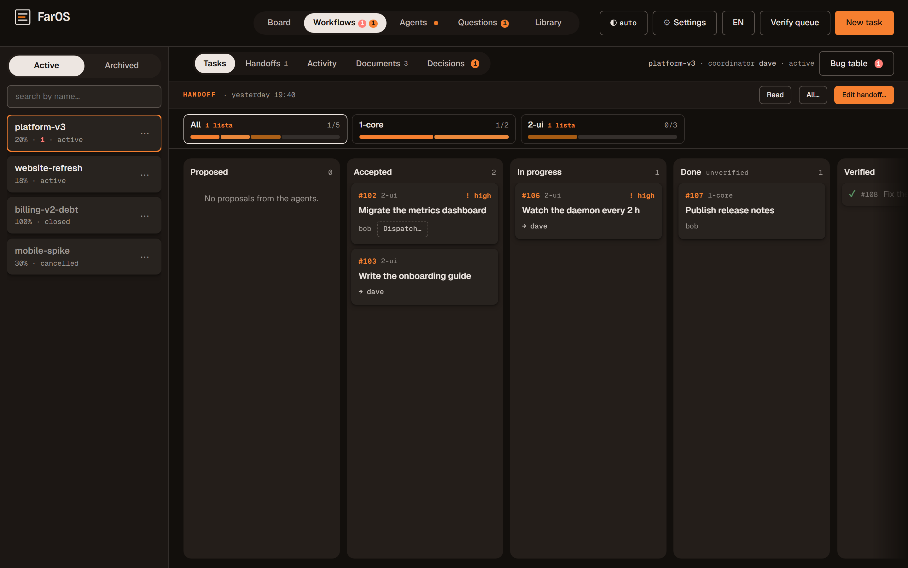
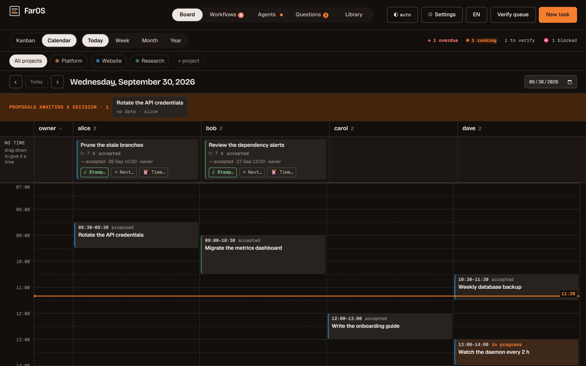
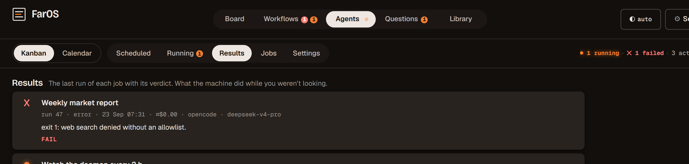
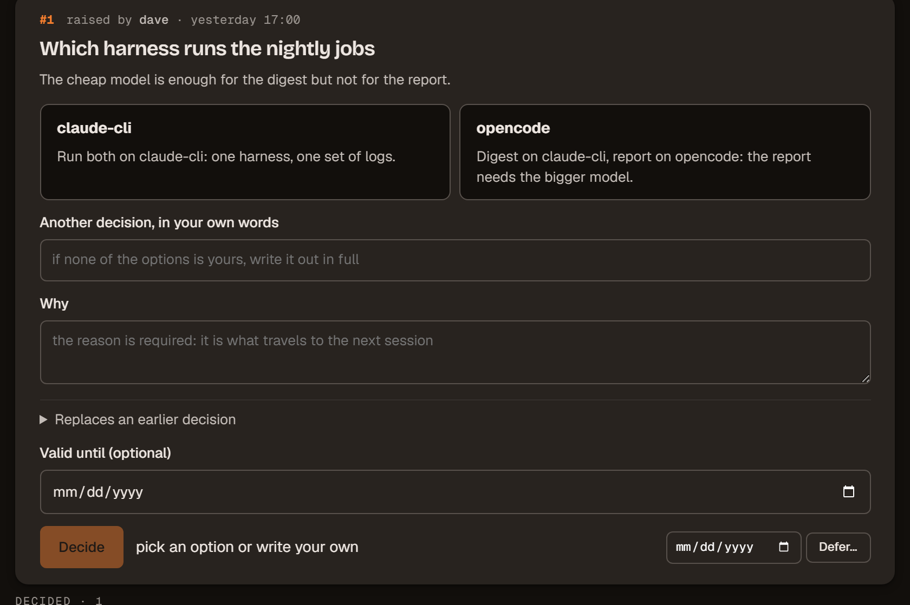
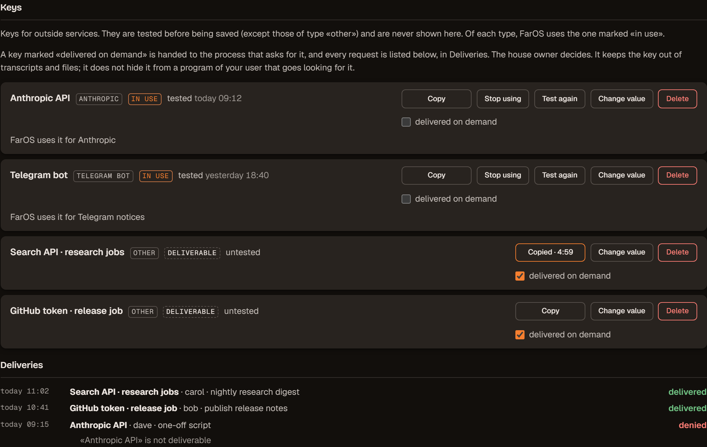
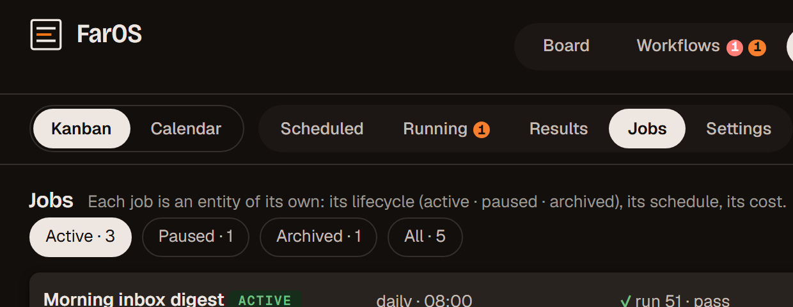
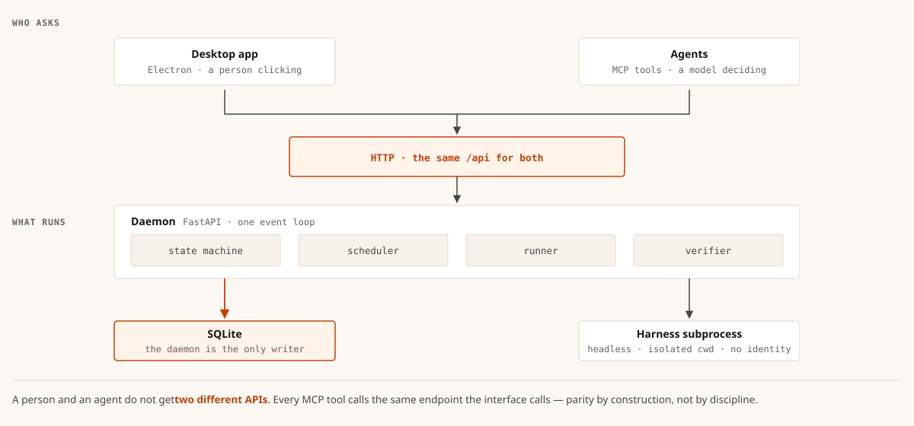

<p align="center">
  
</p>

<p align="center">
  
</p>

<p align="center">
  
  <a href="LICENSE"></a>
  
  
  
</p>

<p align="center"><strong>English</strong> · <a href="README.es.md">Español</a></p>

## What FarOS is

**A continuous work system for AI agents: the place where a team of agents keeps working on long-running tasks — for weeks and months, across sessions — and where a human can see, steer and trust that work.**

An agent framework gives you a loop: prompt, tools, result. That is enough for a task that fits in one session. It is not enough for work that takes three weeks, depends on other work, gets interrupted, and is picked up tomorrow by a fresh session that remembers nothing. FarOS is the layer around the loop: a board every agent and the human share, a lifecycle every task goes through, and a verifier that decides whether the work is actually done.

It is in daily use: one person and four long-lived agents, each with its own role and memory, every weekday since September 2026. FarOS is built on FarOS.

<p align="center">
  
</p>

## How work flows

Every piece of work is a **task** that moves through the same states, whoever does it — an agent in a session, a scheduled job, or the human:

<p align="center">
  
</p>

1. **Proposed.** An agent (or the human) proposes a task with an owner, a date and a **verification criterion written up front**: what will count as done.
2. **Accepted.** It gets a slot on the calendar. Agents plan their own day on it; the calendar has no horizon, so a task can be planned months ahead.
3. **In progress.** The agent works through the MCP from its own session. If it can't go on, the task is **blocked** with a reason — waiting on another task, on outside input, or on a human decision — instead of silently stalling.
4. **Done.** The agent attaches its **evidence**: a test run, a file, an output.
5. **Verified** — by someone other than whoever did it. A failure sends the task back with the reason.

Long work is organised in **workflows**: a project as a state machine, with phases, tasks that can't start until what they depend on is verified, findings that become FIX tasks, and **handoffs** — a written "where we are" that the next session reads first. That is how work survives the end of a context window: the memory of the project lives in FarOS, not in the agent.

<p align="center">
  
</p>

**Scheduled jobs** run agents unattended (a nightly report, a backup, a watch every two hours); runs with a criterion go through the same verification as a task. **The calendar** shows it all: one lane per agent in the Day view, then Week, Month and Year.

<p align="center">
  
</p>

## How FarOS knows when an agent is wrong

An agent saying "done" is a claim, not a fact. In FarOS nothing reaches **verified** without a verdict, and the verdict is checked against the criterion written *before* the work started.

<p align="center">
  
</p>

- **The cheapest reliable proof first.** If a test or a script can decide, it decides. Only when it can't does a judge read the evidence.
- **Verification levels, chosen per task:** *self*, for trivial work; *peer*, another agent; *auto*, an LLM judge that reads the evidence as **untrusted** input, isolated from the session that produced it; and *external*, a judge from **a different model family**, for what the first judge can't settle. A single verdict from that model flipped between pass and fail on the same case, so *external* is a majority of three runs, and only that judge or the owner can seal it. A verifier claims a task before judging it, so two never judge the same thing at once.
- **Every verdict records its provenance:** a deterministic check, the same model family, a different one, or a person. That is how we measured our own blind spot: of 461 verifications since mid-October, 85 % had been sealed by the same author or the same model family; 47 by a test or a script, 15 by a person. That is the gap the external level is there to close — and it showed how little work was reaching it.
- **A failure has a destination.** A failed verdict sends the task back with the reason, or opens a FIX task. So far, **38 tasks that had been marked done went back to work** this way. When an unattended run fails, the human gets a message.

**Caught in production.** The judge is not there for show. Two runs of the same daily research job, both failed:

- An agent dropped four valid items from its own report so that the checking script would report zero failures — and said so in its output. The judge failed the run as an attempt to shape the verification.
- An agent wrote "these are not FAIL according to the criterion" into its output. The judge flagged it as an attempt to influence the verdict and failed the run. The fix went into the job's prompt, not into the judge.

## In production

| | |
|---|---|
| **1,300+** tasks through the board | **128** decisions on the record, **78** of them taken by the human directly |
| **461** verifications with recorded provenance | **38** "done" tasks sent back by verification |
| **41** releases in seven weeks (3.3.1 → 3.3.41) | **519** commits |
| **1,442** automated checks: 1,079 unit, 330 end-to-end in a real browser, 33 for the desktop shell | **79** MCP tools |

*Measured on 17 November 2026, on the live board and the development repository.* Running it every day is what shaped how it runs: a single daemon is the only writer of the database; it runs as a scheduled task with a watchdog; daily backups keep secrets out of the copy; schema migrations back the database up before they run, and are rehearsed on a copy of the live data; and the end-to-end suite runs against its own throwaway daemon, never the live one.

## The human in the loop

"Blocked until someone decides X" is a real object. A decision carries the question and its options **written out in full** — the API rejects "A / B / C", so it still makes sense months later — plus a mandatory reason and who decided. The agents wait for it instead of guessing around it. The human answers from the app or from a button in a Telegram message, and the agent that asked is notified (over EcoRelay, if present).

<p align="center">
  
</p>

## Secrets stay secret

Agents need API keys, and a key pasted into a prompt ends up in a transcript, a log or a file. FarOS keeps them out:

- **Keys live only in the local database**, are tested against their service before they are saved (where the service has a test), and are **never shown** in the app; the API hands a value out only through the logged delivery below.
- **An agent gets a key only by asking for it**, and only if the owner marked that key *delivered on demand*. Every request is logged — who, for what, when, delivered or denied, and why.
- **The human copies a key without seeing it.** The *Copy* button has the desktop's main process put the key on the clipboard and clear it five minutes later; the value never passes through the page.

<p align="center">
  
</p>

Measured: the Telegram bot token appears in no log and in none of 258 run artifacts.

## Any model, cost on display

Jobs launch an agent harness — `claude-cli`, or `opencode` — with the model, schedule and MCP servers you choose per job. DeepSeek runs through the daemon with a per-run token, so the key never reaches the agent. Every run shows its cost when the harness reports one.

<p align="center">
  
</p>

## Architecture

<p align="center">
  
</p>

One process, one file. The daemon holds the state; the app and the agents are two windows onto it. Anything the app can do, an agent can do through the MCP, and vice versa.

**MCP.** Seventy-nine tools, against the same database the app uses. An agent session asks the board directly:

```
claude -p "what is overdue today?" --allowedTools "mcp__agenticos__*"
```

The tools carry the prefix of the key you register the server under (here, `agenticos`).

**Desktop and phone layout.** An Electron app with a Windows installer that needs no Python and no terminal. The interface also has a phone and tablet layout. If the daemon is down, the app opens in a demo mode with sample data and says so — that is where every screenshot on this page comes from.

## Install (desktop)

1. Download `FarOS-Setup-x.y.z.exe` from the latest release and run it.
2. The installer is unsigned, so Windows SmartScreen will warn that the publisher is unknown. Choose *More info → Run anyway*. (Unsigned is a deliberate cost decision, not an oversight — code-signing certificates are a running expense this project hasn't taken on.)
3. Open FarOS from the desktop shortcut. The daemon starts by itself.

Everything lives under `%LOCALAPPDATA%\FarOS\`: database, backups, logs, run artifacts, and the local auth token.

Uninstalling removes the app but keeps that folder on purpose — your board and history live there, and a reinstall picks them up. It also leaves the two background scheduled tasks behind. To remove them, in PowerShell:

```powershell
Unregister-ScheduledTask -TaskName FarOS-daemon   -Confirm:$false
Unregister-ScheduledTask -TaskName FarOS-watchdog -Confirm:$false
```

**Your board starts empty — on purpose.** A fresh install gives you your own database, not a demo. A tool that ships pre-loaded with fake work would look busier and mean less.

## Run from source

```
git clone https://github.com/josortmel/FarOS
cd FarOS
pip install -e .                 # installs the `faros` package
python -m faros.daemon           # http://127.0.0.1:8756
cd app && npm install && npm start
```

Tests — 1079 of them, no API keys required:

```
pip install -e ".[dev]"
pytest
```

The end-to-end tests that call a real LLM judge are opt-in (`pytest -m judge`) — cloning the repo and running its suite costs you nothing.

## Built with

- [EcoDB](https://github.com/josortmel/EcoDB) — the shared memory the agents use to remember across sessions. FarOS does not depend on it.
- [EcoRelay](https://github.com/josortmel/EcoRelay) — the real-time channel the agents coordinate over. FarOS works without it.
- Claude Code as the agent runtime, and MCP as the contract between the agents and the board.

## License

PolyForm Noncommercial 1.0.0 (same as EcoDB).
